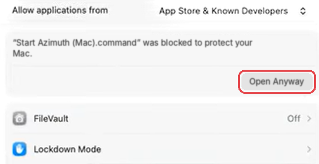

# Azimuth Digital

**Free show playback for Windows and Mac.** Preview, Program, Take: the playback
workflow you already know, built on Chrome's hardware video engine.

## Download

**[Download Azimuth Digital (Windows and Mac)](https://github.com/deadsound/Azimuth-Digital-Releases/releases/latest/download/Azimuth-Digital.zip)**

Also in every [release](https://github.com/deadsound/Azimuth-Digital-Releases/releases/latest):

| File | What it is |
|---|---|
| [Azimuth-Digital-Quick-Start.pdf](https://github.com/deadsound/Azimuth-Digital-Releases/releases/latest/download/Azimuth-Digital-Quick-Start.pdf) | From download to your first take in ten minutes |
| [Azimuth-Digital-User-Manual.pdf](https://github.com/deadsound/Azimuth-Digital-Releases/releases/latest/download/Azimuth-Digital-User-Manual.pdf) | Everything, with pictures |
| [Azimuth-Test-Clips.zip](https://github.com/deadsound/Azimuth-Digital-Releases/releases/latest/download/Azimuth-Test-Clips.zip) | Test clips: frame counters, 4K, HEVC, loops, a still, ProRes to convert |
| [Azimuth-Companion-Module.tgz](https://github.com/deadsound/Azimuth-Digital-Releases/releases/latest/download/Azimuth-Companion-Module.tgz) | Bitfocus Companion module with tally, clip names and time left (also inside the zip) |

## What it does

- **Simple.** Unzip, run, pick your projector, add clips. One screen: Preview,
  Program, Take and the playlist. No licence keys, no dongles, no installer.
- **The workflow you already trust.** Preview in blue, Program in red, Take on
  Enter; signed durations (negative = dissolve, 0 = cut, positive = delay);
  Loop, Freeze and Link; PlaybackPro-style keyboard shortcuts and TCP/UDP
  commands, so existing Companion buttons keep working. OSC for QLab and consoles.
- **Modern codecs at full quality.** H.264, HEVC up to 4K and 10-bit, VP9 with
  transparency, and AV1, decoded in hardware on the graphics card where it
  supports them. ProRes and DNxHD convert in one click on the graphics card's
  encoder; originals are never touched.
- **Its own render engine.** With the GPU renderer switched on, Azimuth draws
  every frame itself with WebGPU: dissolves, fades, levels and geometry on the
  graphics card.
- **Confidence everywhere.** Live Preview and Program pictures on the operator
  screen, a view-only monitor page with countdown for any phone or tablet on
  the network, audio meters, and computer load at a glance.
- **Free.**

## Requirements

- **Windows 10 or 11 (64-bit)** with Google Chrome (or Microsoft Edge). A
  graphics card with hardware HEVC decoding is recommended for 4K.
- **Mac:** the same download, with Google Chrome. Open
  *Start Azimuth (Mac).command*: the first time it offers to download the
  Node.js it needs into the Azimuth folder.

## Start

1. Unzip anywhere, for example to the Desktop.
2. Double-click **Azimuth Digital.exe** (Mac: *Start Azimuth (Mac).command*).
   The operator screen opens in Chrome, and Azimuth's icon sits in the
   notification area: right-click it for the output, the logs and Quit.
3. **Output setup** › **Detect displays** › **Fullscreen output here** on your
   projector, then **Add clips…**. The quick start guide walks through the rest.

### First start on a Mac

Azimuth is not yet signed with Apple, so the first time (and after each
update) macOS asks you to allow the start script once:

1. macOS says *Apple could not verify "Start Azimuth (Mac).command" is free of
   malware*. Click **Done** (not Move to Trash).
2. Apple menu › **System Settings** › **Privacy & Security**, scroll down to
   **Security** and click **Open Anyway** beside the blocked script.

   
3. Click **Open Anyway** again and confirm with your password or Touch ID.
   Azimuth starts in a Terminal window; keep it open during the show.
   If macOS says instead *Sandbox is not allowed to open documents in
   Terminal*, click OK and double-click the script again: it is allowed now.

If macOS says instead that you do not have permission to open the script, open
**Terminal**, type `bash ` (with a space), drag the script into the window and
press Return.

**Updating on a Mac:** unzip the new version as a new folder and move `Media`,
`Shows`, `config.json` and `tools` from the old folder into it. Don't replace
the old folder with the new one in Finder: that throws your shows away.

## Help

Press **F1** (or **Help**) in Azimuth for the manual.

Found a bug? **[Report it here](https://github.com/deadsound/Azimuth-Digital-Releases/issues/new?template=bug_report.yml)**.
The form asks for your Azimuth version, computer and graphics card, and the day's
log file from the Logs folder. For questions and ideas,
[open an issue](https://github.com/deadsound/Azimuth-Digital-Releases/issues/new).

---

## License

Azimuth Digital is free to use on any number of computers, including for paid
and commercial shows. Please share the link to this page rather than the
download itself, so everyone gets the current version. It comes with no
warranty: test your show and keep a backup. The full terms are in
[LICENSE.txt](LICENSE.txt), which is also in the download.

PlaybackPro is a trademark of DT Videolabs;
Azimuth Digital is independent and not affiliated with DT Videolabs. Chrome is
a trademark of Google LLC.
